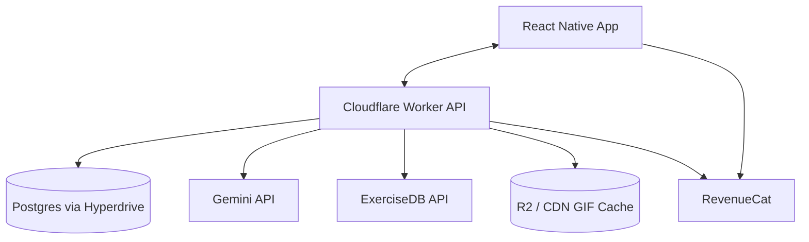
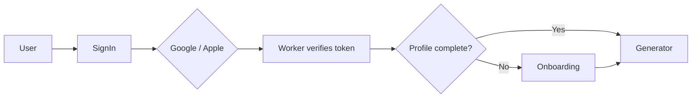
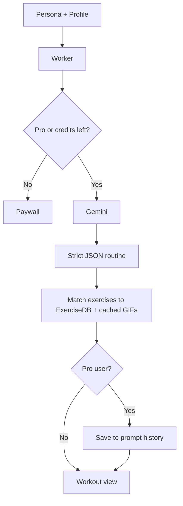

## Fan Fit Project Specifications

🏋️ **Train like your icons.** AI-generated workouts themed around your favorite athlete/sport, character, or artist.

---

## 📌 Problem (Core Idea)

Gym-goers and fitness first-timers suffer from **"workout paralysis"**: they arrive at the gym without knowing:

- Which exercises to do
- How to structure the session
- How many sets and reps fit their level
- How to perform each movement with good form

Generic workout templates feel impersonal and are easy to abandon.

➡️ **Fan Fit bridges fandom and fitness.** Enter a favorite athlete/sport, fictional character, superhero, musician, or actor, and get a realistic, scientifically sound conditioning routine themed around that persona.

---

## 🧑‍💻 Users

| Persona              | Needs                                                      |
| -------------------- | ---------------------------------------------------------- |
| Sports Fan           | Train like their favorite athlete or sport                 |
| Pop Culture Fan      | Motivation from anime, movie, superhero, or music icons    |
| Fitness First-Timer  | Clear exercise selection and form demonstrations           |
| Intermediate Lifter  | Fresh, structured sessions instead of repeating templates  |

- **Experience level:** Mostly beginners and intermediates
- **Usage pattern:** Focused, personal, solo workout tool. No social feed.

---

## ✨ Core Features

### A) Social Onboarding

- Quick sign-in with **Google** or **Apple**
- Immediate profile setup:
  - Gender
  - Activity level (sedentary → very active)
  - Age
  - Preferred workout length (30 / 45 / 60 min)

### B) AI Persona Generator

Users select or type the persona that inspires the session:

- Athlete / sport
- Fictional character / superhero
- Musician
- Actor

Gemini generates a routine themed around that persona, scaled to the user's profile.

### C) Structured Workout View

Clean, distraction-free scrollable list showing:

- Sections (warm-up, main work, conditioning, cool-down)
- Set / rep breakdown
- Target muscle groups
- Exercise demo GIF

### D) Exercise Demo Library

- High-quality motion **GIFs from ExerciseDB** embedded for every exercise
- Replaces the current prototype's YouTube tutorial videos

### E) Fresh Session Generation

- Fast, low-friction entry point to generate a new workout every gym visit

### F) Prompt History (Pro)

- Pro users' generated workouts are saved and can be revisited
- Free users' workouts are not saved

---

## 🗄️ Data Model (Rough Draft)

> Postgres with Drizzle ORM. This is a starting point and **will evolve**.

### Users

| Field                      | Notes                                                       |
| -------------------------- | ----------------------------------------------------------- |
| ID                         | Unique ID                                                   |
| OAuth Provider             | `google` or `apple`                                         |
| OAuth Provider ID          | Unique ID from the sign-in provider                         |
| Email                      | Unique                                                      |
| Gender                     | `female`, `male`, `non_binary`, `prefer_not_to_say`         |
| Activity Level             | `sedentary`, `light`, `moderate`, `active`, `very_active`   |
| Age                        | Number                                                      |
| Preferred Workout Length   | 30, 45, or 60 minutes (default 45)                          |
| Subscription Tier          | `free` or `pro` (default `free`)                            |
| Monthly Generations Used   | Counter for the free tier limit                             |
| Credit Period Start        | When the monthly counter last reset                         |
| Created At / Updated At    | Timestamps                                                  |

### Workouts (Prompt History, Pro only)

| Field          | Notes                                                     |
| -------------- | --------------------------------------------------------- |
| ID             | Unique ID                                                 |
| User ID        | Links to the user                                         |
| Persona Query  | What the user typed or selected                           |
| Routine        | Gemini's JSON routine, checked against the frontend types |
| Created At     | When the workout was generated                            |

### Exercise Cache

| Field         | Notes                                    |
| ------------- | ---------------------------------------- |
| ID            | Unique ID                                |
| Name          | Exercise name                            |
| Muscle Group  | Target muscles                           |
| Equipment     | Equipment type                           |
| External ID   | ExerciseDB reference ID (unique)         |
| GIF URL       | Cached copy on Cloudflare R2 / CDN       |

---

## 🧱 Tech Stack

| Category          | Choice                                             |
| ----------------- | -------------------------------------------------- |
| Mobile Frontend   | **React Native (Expo)**, iOS & Android             |
| Language          | TypeScript (strict, frontend and backend)          |
| Backend Runtime   | Cloudflare Workers                                 |
| Database          | PostgreSQL via Cloudflare Hyperdrive + Drizzle ORM |
| AI                | Google Gemini API (structured JSON output)         |
| Exercise Data     | ExerciseDB (exercise metadata + GIFs)              |
| Media Caching     | Cloudflare CDN / R2                                |
| Auth              | Google & Apple sign-in                             |
| Subscriptions     | RevenueCat (Apple IAP + Google Play Billing)       |

### ⚡ Latency Strategy

- **AI loading UI:** Skeleton and loading indicators while Gemini generates
- **Edge caching:** ExerciseDB GIFs cached on Cloudflare CDN / R2 to avoid buffering on cellular
- **Connection pooling:** Hyperdrive removes cold-start database connection overhead

---

## 💰 Monetization

| Plan | Price                | Limits                        | Features                                         |
| ---- | -------------------- | ----------------------------- | ------------------------------------------------ |
| Free | $0                   | 3 AI generations per month    | Full workout view + demo GIFs                    |
| Pro  | $12.99               | Unlimited                     | Unlimited AI workout generations, prompt history |

> RevenueCat manages subscriptions and entitlement checks

---

## 🎨 UI / UX

- Dark mode, clean and minimalist
- High-contrast green accents

### Color Palette

| Role                     | Hex       |
| ------------------------ | --------- |
| Primary Accent Green     | `#009C15` |
| Secondary Green          | `#156920` |
| Deep Forest Accent       | `#15361A` |
| Dark Charcoal Container  | `#1F3321` |
| Deep Background Charcoal | `#29332A` |

### Screen Flow

1. Social authentication
2. Onboarding profile setup (gender, activity level, age, workout length)
3. AI persona generation
4. Scrollable workout & demo view

> Reference designs: `context/screenshots/`

---

## 🔌 API Architecture

API layers stay modular: Gemini completions, RevenueCat entitlement checks, and ExerciseDB lookups each live in separate modules.

---

## 🔐 Auth Flow

---

## 🧠 AI Workout Generation Flow

### Gemini Prompt Rules

- System prompts **must enforce a strict JSON schema** that matches the frontend's exercise types
- Routines must be realistic athletic conditioning, scaled to gender, activity level, age, and workout length
- No non-functional gimmick exercises

---

## 🗂️ Development Workflow

- **One branch per feature**
- Track progress in `context/current-feature.md`; feature specs live in `context/features/`
- **Claude Code** as the AI coding assistant
- Commits must **not** include a `Co-authored-by` trailer or any co-author metadata

---

## 🧭 Roadmap

### **MVP**

- Google / Apple sign-in
- Onboarding profile setup
- AI persona generator (Gemini)
- Scrollable workout view with ExerciseDB GIFs
- Free tier limit (3 generations / month)

### **Pro Phase**

- RevenueCat subscriptions (monthly / annual)
- Paywall and upgrade flow
- Unlimited generations
- Prompt history

### **Future Enhancements**

- TBD

---

## 📌 Status

- On-device Expo prototype exists (rule-based generation, YouTube tutorials, no backend)
- Current feature: main menu redesign (see `context/current-feature.md`)
- Backend, auth, AI, and subscriptions not started

---

🏗️ **Fan Fit — Train Like Your Icons.**
